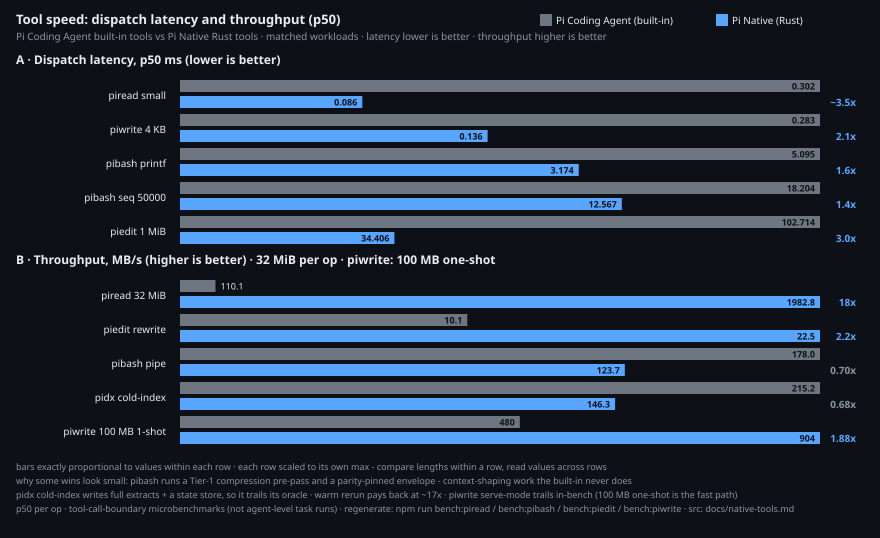
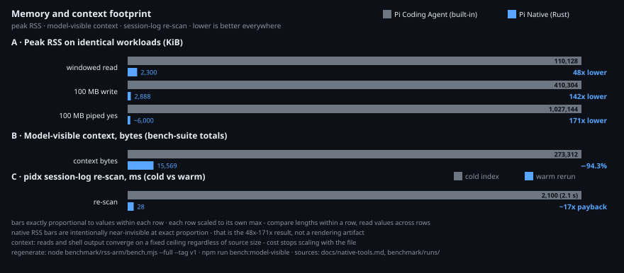

# pi-native

A measured performance harness for the official Pi coding agent: native Rust tools, fail-closed permission gates, and token-efficient context management layered on top of unmodified Pi.


[](https://github.com/nurmdrafi/pi-native/stargazers)
[](https://github.com/nurmdrafi/pi-native/actions/workflows/ci.yml)
[](tests/)
[](https://github.com/nurmdrafi/pi-native/releases)
[](https://github.com/nurmdrafi/pi-native/commits)
[](LICENSE)
[](https://hub.xerj.org/contributors/nurmdrafi)
[](https://github.com/earendil-works/pi-coding-agent)
[](docs/design-rules.md#portability)[](docs/design-rules.md#portability)
[](#quick-start)
[](docs/subagents.md)
[](docs/skills.md)
[](extensions/README.md)
[](https://github.com/nurmdrafi/pi-native/issues)
[](https://github.com/nurmdrafi/pi-native/graphs/contributors)
<br>
[](#quick-start)

pi-native is **not** a rewrite of Pi Coding Agent. It is a performance layer on top of the official agent, [earendil-works/pi-coding-agent](https://github.com/earendil-works/pi-coding-agent). The agent you run stays official; pi-native never forks it.

Nothing is migrated or replaced. Existing sessions, skills, extensions, and auth keep working where they are: pi-native drops in as the `~/.pi/agent` config directory and swaps the tool layer underneath.

**Same Pi, much faster tools + much less context bloat.** Both halves are measured; every number below comes from the benchmark harness in this repo.

##  Why this exists

Coding-agent configs decay: always-on prompt bloat, machine-specific paths, undocumented setup rituals. This harness treats the config as an engineered product: one `~/.pi/agent/` directory configures a coding-agent workstation on any macOS or Linux machine — lean behavioral core, skills loaded only on invocation, always-on extensions enforcing tool-call rules, permanent prompt prefix under a kilotoken. Every harness change ships with a before/after number.

##  What it does

- Native Rust tools (`piread`, `piedit`, `pibash`, `piwrite`, `pidx`) replace `read`, `edit`, `bash`, `write`, and session-log parsing — same parameters, so a tuned pi setup runs unchanged ([docs/native-tools.md](docs/native-tools.md))
- Every tool call crosses a permission gate before it runs ([docs/rust-tools-architecture.md](docs/rust-tools-architecture.md))
- Context stays small by default: windowed reads, bounded diffs, hard output caps ([docs/native-tools.md](docs/native-tools.md))
- Dashboard shows token spend, cache hit rate, and per-session USD budget alerts ([dashboard/](dashboard/))
- Subagents run sandboxed with the gate re-enabled inside; each child declares its write scope, so parallel work never clobbers files ([docs/subagents.md](docs/subagents.md))
- Zero init: clone into `~/.pi/agent`; every later pull re-checks the setup itself ([docs/zero-init.md](docs/zero-init.md))
- No silent fallback: native tools always execute the Rust binary; terminal failure throws an error plus one stderr line; built-ins only by explicit configuration ([docs/native-tools.md](docs/native-tools.md))

##  Benchmarks

Measured p50, built-in Pi tools vs Pi Native Rust tools, matched workloads. Bars are exactly proportional within each row (each row scaled to its own max); rows trading speed for smaller context say so in the chart notes:





##  Quick start

Prereqs: git; Rust (cargo); macOS or Linux; tmux only for subagents.

```sh
# 1. Node ≥ 22.19 (`.nvmrc` pins 24)
nvm install 24

# 2. Install pi (official installer; pins deps, adds `pi update`)
curl -fsSL https://pi.dev/install.sh | sh

# 3. Clone the harness into pi's config dir
git clone https://github.com/nurmdrafi/pi-native.git ~/.pi/agent

# Per machine: copy extras from an existing machine
scp <your-other-machine>:~/.agents/skills/* ~/.pi/agent/skills/  # private skills, not in the repo
scp <your-other-machine>:~/.pi/agent/auth.json ~/.pi/agent/      # secrets, or /login per provider inside pi
```

Every later `git pull` re-checks the setup: husky `post-merge`/`post-rewrite` run `scripts/after-pull.sh`, which refreshes npm deps when the lockfile moved, recreates the `pidoc` shim, rebuilds stale Rust tools, then runs `pidoc --fix`. It applies safe non-privileged fixes automatically and reports missing toolchains, never installing them.

Verify and start pi:

```
$ ~/.pi/agent/bin/pidoc
# expect 0 FAIL (warnings OK; e.g. no cargo yet means session-audit uses its Node fallback)

$ pi
# First run regenerates npm/, git/, models-store.json automatically; bin/ came from bootstrap.
```

Subagents need tmux: `brew install tmux` (macOS) or `sudo apt install tmux` (Linux).

Add `bin/` to `PATH` so terminals resolve the same tools (zsh: `~/.zshenv`; bash: `~/.bashrc`):

```sh
export PATH="$HOME/.pi/agent/bin:$PATH"
```

`bin/` is gitignored and regenerated: `rg` (PCRE2 build), `piread`, `piedit`, `pibash`, `piwrite`, `pidx`, `fd`, `pidoc`. `pidoc` verifies all of them; check the `rg-pcre2`, `piread`, and `shell-path` rows.

##  Architecture

<p align="center">
  
</p>

▶ Interactive view: [pi-native architecture](https://htmlpreview.github.io/?https://github.com/nurmdrafi/pi-native/blob/main/docs/assets/diagrams/pi-native-architecture.html)

Every tool call: the extension intercepts the built-in call, the permission gate authorizes it fail-closed, the Rust binary executes it — persistent daemon (`--serve`, NDJSON over stdio) on the hot path, one-shot spawn as fallback. Terminal failure throws a tool error plus one stderr line, never a silent built-in run. Tests pin daemon and one-shot paths byte-identical; `details.via` records the serving path. Deep dive: [docs/rust-tools-architecture.md](docs/rust-tools-architecture.md).

##  Skills & subagents

Skills are manual (`/skill:<name>`) and validator-enforced; bodies enter context only when invoked ([docs/skills.md](docs/skills.md)).

Each spawn declares its write scope: overlapping spawns queue FIFO behind the owner; disjoint work runs fully parallel — no hand-planning around file collisions. Subagents run on tmux, gated off by default, sandboxed with the permission gate re-enabled inside. Per-child budgets (wall-clock, turns, USD) stop at the limit; only summaries return to the parent; the dashboard tracks each child's health and cost live. Deep dives: [docs/subagents.md](docs/subagents.md) · [docs/subagent-orchestration.md](docs/subagent-orchestration.md) · [extensions/subagents/README.md](extensions/subagents/README.md)

##  Environment keys

Native-tool spawns re-set the session keys from the live tool context (`extensions/pibash/index.ts`); subagent workers get identity keys on spawn (`extensions/subagents/index.ts`). User-set knobs pass through the same environments:

| Key                   | Set by     | Carries                                                        |
| --------------------- | ---------- | -------------------------------------------------------------- |
| `PI_SESSION_ID`       | pibash     | current session id                                             |
| `PI_SESSION_FILE`     | pibash     | session file path                                              |
| `PI_PROVIDER`         | pibash     | active model provider                                          |
| `PI_MODEL`            | pibash     | active model id                                                |
| `PI_REASONING_LEVEL`  | pibash     | thinking level, when one is active                             |
| `PI_CODING_AGENT_DIR` | override   | agent config dir (default `~/.pi/agent`); forwarded to workers |
| `PI_SUBAGENT_NAME`    | subagents  | worker display name                                            |
| `PI_SUBAGENT_MAX_CONCURRENT` | user | cap on simultaneous subagent spawns (default 5; <1 unlimited) |
| `PI_PIDX_MAX_INLINE`  | user       | pidx inline-output cap before spill (default 2000)             |
| `PI_DASH_PORT`        | user       | dashboard server port (`npm run dashboard`; default 8787)      |
| `PI_DASH_SESSIONS_DIR`| user       | dashboard sessions tree to index (default `~/.pi/agent/sessions`) |
| `PI_DASH_SESSION_BUDGET` | user  | dashboard per-session cost budget in USD for alerts (0 disables) |

Workers also inherit the internal parent-to-child plumbing (`PI_SUBAGENT_AGENT`, `PI_SUBAGENT_SESSION`, `PI_SUBAGENT_ID`, `PI_SUBAGENT_ALLOWED`, `PI_SUBAGENT_ACTIVITY_FILE`, `PI_SUBAGENT_SURFACE`, `PI_SUBAGENT_AUTO_EXIT`), classified in the env-var allowlist in [rust-tools/docheck/src/main.rs](rust-tools/docheck/src/main.rs).

##  How you can help

- **small**: run a benchmark arm from [benchmark/runs/](benchmark/runs/) on your hardware and file the numbers — host-noise bounds sharpen with every report.
- **small**: docs fixes — broken anchors, stale numbers, clearer quick-start steps.
- **medium**: new skills under [skills/](skills/): one skill, one job, validator-clean (`npm run check`).
- **medium**: portability reports — shells and package managers beyond the tested set (zsh, bash; brew, apt).
- **larger**: attack a losing or parity row in the [benchmarks](#benchmarks); the harness, corpus generator, and raw results are in-tree.

Issues and PRs: [issue tracker](https://github.com/nurmdrafi/pi-native/issues).

##  Docs

- [Native tools](docs/native-tools.md): tools, env keys, performance, context shaping
- [Architecture](docs/rust-tools-architecture.md): dispatch ladder, daemon protocol, per-tool pipelines
- [Skills](docs/skills.md): roster and validator-enforced layout
- [Subagents](docs/subagent-orchestration.md): gating, sandboxing, agent table
- [Zero-init](docs/zero-init.md): the two-rung bootstrap ladder and what the hot path costs
- [Design rules](docs/design-rules.md): context layers, token budget, portability
- [Development](docs/development.md): repo layout, scripts, sync, providers
- [Benchmarks](benchmark/README.md): harness arms, raw runs, filing numbers on your hardware
- [extensions/README.md](extensions/README.md): extension and permission-gate rule catalog
- [CHANGELOG.md](CHANGELOG.md): every change with what / why / risk / measured delta

##  Development

Requirements: Node ≥ 22.19 (`.nvmrc` pins 24), Rust (cargo) for the native tools, tmux only for subagents. Bootstrap never installs a toolchain; it prints the missing command.

```sh
sh scripts/bootstrap.sh  # fresh clone → working setup: npm deps, pi links, pidoc shim, Rust builds
npm run check           # typecheck → agents lint → doc check → tests (full pre-commit gate)
npm run gate:eval       # permission-gate fixture metrics (one final JSON line)
npm run daemons:kill    # kill stale native daemons after a rebuild
```

Sync is plain git: push from the source machine, `git pull` on the target (husky re-runs `scripts/after-pull.sh`); `sh scripts/bootstrap.sh` covers a fresh clone. Script table, providers, and machine-local paths: [docs/development.md](docs/development.md).

##  License

[MIT](LICENSE) © nurmdrafi
