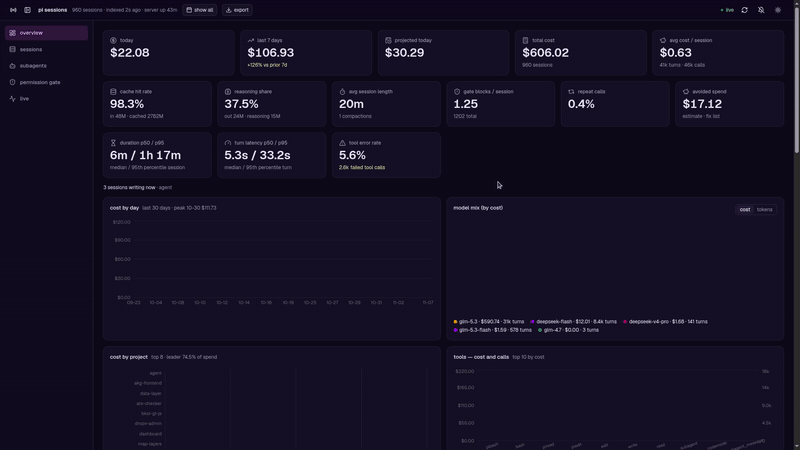

# pi-native

Fail-closed trust and a measured token economy: a Pi harness with native Rust tools.

Why:

- Fail-closed native gates — every tool call crosses an explicit permission gate before it runs ([docs/rust-tools-architecture.md](docs/rust-tools-architecture.md))
- Measurable token economy — the `pi sessions` dashboard tracks token spend per session and run ([dashboard/PRODUCT.md](dashboard/PRODUCT.md))
- Drop-in pi harness compatibility — native tools match the pi built-ins' parameters verbatim, so existing setups work unchanged ([docs/native-tools.md](docs/native-tools.md))


[](https://github.com/nurmdrafi/pi-native/stargazers)
[](https://github.com/nurmdrafi/pi-native/actions/workflows/release.yml)
[](https://github.com/nurmdrafi/pi-native/actions/workflows/ci.yml)
[](https://github.com/nurmdrafi/pi-native/releases)
[](LICENSE)
[](https://hub.xerj.org/contributors/nurmdrafi)
[](https://github.com/earendil-works/pi-coding-agent)
[](docs/design-rules.md#portability)[](docs/design-rules.md#portability)
[](#requirements)
[](docs/subagents.md)
[](docs/skills.md)
[](extensions/README.md)
[](https://github.com/nurmdrafi/pi-native/issues)
[](https://github.com/nurmdrafi/pi-native/graphs/contributors)
[](https://github.com/nurmdrafi/pi-native/commits/dev)
<br>
[](#requirements)

## Why this exists

Coding-agent configs rot — they accumulate always-on prompt bloat, machine-specific paths, and undocumented setup rituals. This harness treats the config as an engineered product: one `~/.pi/agent/` directory that turns any macOS or Linux machine into a fully configured coding-agent workstation in minutes, with a lean behavioral core, progressive-disclosure skills, always-on extensions that enforce discipline at the tool-call level, and a permanent prefix small enough to measure in fractions of a kilotoken. Every harness change ships with a before/after number.

## Trust

- Fail-closed permission gates — every tool call crosses a gate before it runs ([docs/rust-tools-architecture.md](docs/rust-tools-architecture.md))
- No silent fallback — a terminal native-tool failure is a thrown error plus one stderr line, never a masked built-in; built-in selection is explicit configuration ([Daemon → One-Shot Ladder](#daemon--one-shot-ladder), [docs/native-tools.md](docs/native-tools.md))
- MCP runs disabled by default — the built-in extension is off and native tools replace `bash`, `read`, and `edit` ([docs/development.md](docs/development.md))
- Subagents gated and sandboxed — spawn tools are gated, children run in isolated panes under hard conduct bans ([docs/subagent-orchestration.md](docs/subagent-orchestration.md), [docs/subagents.md](docs/subagents.md))
- Supported platforms: macOS and Linux — portability rules are enforced ([docs/design-rules.md](docs/design-rules.md#portability))

## Demo



One gated native tool call and one dashboard render, about 15 seconds. The recording is pending — [docs/assets/demo-placeholder.md](docs/assets/demo-placeholder.md) defines what it must show (asciinema or GIF, at most 3 MiB).

## What it does

The pi-native harness optimizes agent execution loops by replacing built-in tool functionalities with **five** native Rust crates. It functions as a **transparent, high-throughput co-processor**, offloading heavy string validation, windowed file reading, and shell output filtering from the single-threaded Node.js event loop while maintaining strict parity with the upstream platform API.

### Daemon → One-Shot Ladder
Each native utility runs the same **two-rung ladder**: a **persistent background daemon process (`--serve`)** over NDJSON stdio, then a **one-shot CLI spawn** when the daemon transport fails. There is no third rung and no functional fallback: a terminal failure — missing binary, unhandled panic, unparseable output — is a thrown tool error plus one stderr line, so a broken binary is visible instead of silently masked. Choosing pi's built-in tool instead is configuration: leave the extension out, or set the permission-gate `nativeReadFirst` / `nativeBashFirst` rules to `off`.

*   **`piread` (Windowed Context Truncation Driver):** Replaces default text file reading routines by deploying **windowed reads with head-tail compaction**. The **persistent daemon path** operates at a p50 latency threshold of **0.03 to 0.39 ms** below the built-in tool across all **seven** corpora (achieving up to a **3.4x performance speedup** on small file reads), keeping the transcript completely byte-identical on cases within the budget.
*   **`piedit` (Fuzzy Normalized Diff Processor):** Optimizes file modification operations via **exact-then-fuzzy matching (NFKC, smart quotes, CRLF)** backed by a **native diff/patch engine**. It delivers a **2.7x performance acceleration** over standard tools on **1 MiB** source files while maintaining **Anchor Guard parity** and strict line-coverage tracking.
*   **`pibash` (Command-Kind Output Stream Filter):** Implements **command-kind-aware compression**, **run deduplication**, and low-overhead **ANSI strip processing**. It executes faster than its baseline oracle across all **nine** core command classes, tracking down to a absolute latency drop of **−5.64 ms** on `seq 50000` data arrays. Output that breaches token thresholds is automatically captured via a **spill-to-file fallback** that outputs a recovering path.
*   **`pidx` (Byte-Offset Spending Cache Indexer):** Scans multi-megabyte log assets incrementally by preserving raw file byte pointer offsets via a **stateful size and modified-time (`mtime`) cache**. It shifts performance from a 2.1-second structural parse down to a **28 ms warm runtime**, delivering a **75x incremental acceleration** when calculating real-time model spend profiles from a **110 MB** log trace.
*   **`docheck` (Markdown Syntax and Inventory Linter):** Audits markdown command blocks, terminal parameter flags, directory paths, tool inventories, and environment variable allowlists. It operates completely out-of-process to complete **structural validation sweeps** across **697** distinct files in just **1.9 seconds**, delivering an ultra-low latency timeline across large documentation assets.


### Stream Compression and Permission Interception Loops
*   **Deterministic Head-Tail Output Compaction:** Clamps streaming console blocks and reading inputs at a hard **40-line / 2 KB** ceiling using a **deterministic head-tail compaction algorithm**. It compresses **273 KB** of raw log data down to **15.6 KB** of high-density, model-visible context, yielding a **94.3%** reduction in overall token footprints while keeping errors, exit codes, and a certified **omission map** intact.
*   **Fail-Closed Tool-Call Interception Gate:** Evaluates tool execution parameters synchronously against **31** granular safety rules, guarding against path traversal, runaway prompt loops, and destructive shell payloads. Rather than failing the process hard, the gate intercepts violations and employs a **Block + Targeted Fix design** that injects synthetic remediation context straight to the model turn, keeping **92** fixtures green at **93%** one-shot block recovery.
*   **Sandboxed tmux Subagent Sandboxing:** Allocates background worker context within dedicated, **sandboxed tmux workspaces**. Internal **parent-to-child plumbing environment keys** pass tracking values and identity metrics dynamically, keeping subagent context requirements at **zero** tokens until a task is explicitly delegated.

## Quick start

Node, pi, the repo — then bootstrap. Prereqs: git; tmux only for subagents.

```sh
# 1. Node ≥ 22.19 (`.nvmrc` pins 24)
nvm install 24

# 2. Install pi (official installer; pins deps, adds `pi update`)
curl -fsSL https://pi.dev/install.sh | sh

# 3. Clone the harness into pi's config dir
git clone https://github.com/nurmdrafi/pi-native.git ~/.pi/agent

# Additionally, per machine — copy extras from an existing machine
scp <your-other-machine>:~/.agents/skills/* ~/.pi/agent/skills/  # private skills, not in the repo
scp <your-other-machine>:~/.pi/agent/auth.json ~/.pi/agent/      # secrets — or /login per provider inside pi

# 4. Bootstrap — npm deps, pidoc shim, Rust tool builds (cargo missing is reported, never auto-installed)
sh ~/.pi/agent/scripts/bootstrap.sh
```

After bootstrap, later `git pull`s re-check the setup automatically — husky `post-merge`/`post-rewrite` run `scripts/after-pull.sh`: refresh npm deps when the lockfile moved, recreate the `pidoc` shim, rebuild Rust tools when stale, then run `pidoc --fix`. Safe non-privileged fixes apply automatically; missing toolchains are reported, never installed.

Verify and start pi:

```console
$ ~/.pi/agent/bin/pidoc
# expect 0 FAIL (warnings OK — e.g. no cargo yet means session-audit uses its Node fallback)

$ pi
# First run regenerates npm/, git/, models-store.json automatically; bin/ came from bootstrap.
```

Optional, for subagents: `brew install tmux` (macOS) or `sudo apt install tmux` (Linux).

Add `bin/` to your `PATH` so your own terminals resolve the same tools — zsh: `~/.zshenv`, bash: `~/.bashrc`:

```sh
export PATH="$HOME/.pi/agent/bin:$PATH"
```

`bin/` is gitignored and regenerated. It holds `rg` (built with PCRE2), `piread`, `piedit`, `pibash`, `pidx`, `fd`, and `pidoc`. `pidoc` verifies all of them — look for the `rg-pcre2`, `piread`, and `shell-path` rows.

## Requirements

| Requirement  | Detail                                                |
| ------------ | ----------------------------------------------------- |
| Node.js      | ≥ 22.19 (`.nvmrc` pins 24, the current LTS)           |
| OS           | macOS or Linux                                        |
| Rust (cargo) | Builds the native tools                               |
| tmux         | Only for subagents — [docs/subagent-orchestration.md](docs/subagent-orchestration.md) |
| Git          | For sync; `~/.pi/agent` is itself a repo              |

Native tools register unconditionally and always execute the Rust binary; no env switch turns one off or hands the work to a built-in. Choosing pi's built-in `read`/`bash`/`edit` is configuration: do not load that extension, or flip the permission-gate rule that steers calls to it (`nativeReadFirst` / `nativeBashFirst` in `extensions/permission-gate/config.json`, or `PGATE_CONFIG`).

## Benchmarks


Methodology: tool-call-boundary microbenchmarks (dispatch / serve protocol), not agent-level task runs; p50 per op, one representative case per tool — raw data in [benchmark/](benchmark/), [benchmark/runs/](benchmark/runs/), and [results NDJSON](benchmark/piwrite/results/results-2026-11-05-rawframe3.ndjson).

## Architecture

<p align="center">
  
</p>

▶ Explore the interactive view: [pi-native architecture](https://htmlpreview.github.io/?https://github.com/nurmdrafi/pi-native/blob/main/docs/assets/diagrams/pi-native-architecture.html)

Every rung byte-matches the one below it (parity-pinned by tests); `details.via` records which rung served the call. Deep dive: [docs/rust-tools-architecture.md](docs/rust-tools-architecture.md).

## Native tools

| Tool     | Replaces                | One line                                                    |
| -------- | ----------------------- | ----------------------------------------------------------- |
| `piread` | built-in `read`         | windowed reads with head-tail compaction                    |
| `piedit` | built-in `edit`         | bounded diffs, Anchor Guard parity                          |
| `pibash` | built-in `bash`         | command-aware output shaping, spill file                    |
| `pidx`   | Node session-log parser | incremental extracts, pointer-only output                  |

Tools, env keys, benchmarks, and context-shaping tables: [docs/native-tools.md](docs/native-tools.md).

## Subagent orchestration

A subagent orchestration runtime built into the harness: parallel throughput without merge conflicts, tokens spent once, children that finish or say why — [docs/subagents.md](docs/subagents.md).

*   **Runtime-owned file-conflict safety:** a spawn declares its write scope; an overlapping spawn queues FIFO behind the owner while non-conflicting work keeps launching (skip-scan queue), so disjoint file-sets stay fully parallel and orchestrators stop hand-planning around collisions.
*   **Cross-agent memory:** every result appends to an append-only per-repo history; a child whose scope overlaps recent work receives an injected prior-work digest (changed paths, diff excerpt, summary), so followers skip re-reading files a teammate just changed.
*   **Duplicate-spawn detection:** a near-identical same-agent re-spawn draws a warn-only note before you pay for it — steer the running child or re-check the prior result.
*   **Measured time-sense:** spawn acks carry per-agent baselines from your own history (``typical for `worker`: median 5m · p90 15m · $0.34``); a child running past its agent's p90 is flagged live.
*   **Full control plane:** `cancel` walks interrupt → grace → kill through one delivery funnel (exactly one result), `restart` re-dispatches, steer/resume verbs reach running or finished children, and per-child budgets (wall-clock, turns, USD) are enforced with stops.
*   **Failure recovery:** pane loss self-heals with one auto-restart, a window too full for a new pane makes room by closing the oldest subagent pane, the next session adopts orphans, and budget kills plus crash residue still deliver — a dead child's work arrives.
*   **Token discipline:** work happens in isolated child contexts and only summaries return to the orchestrator; inspection is pull-based (zero parent tokens until asked), and a delegation gate keeps small tasks linear so parallelism is spent only where it pays.
*   **Live dashboard:** per-child health and metric cards with deep links — [dashboard/](dashboard/).

Verbs, scope locks, agent table, triage: [extensions/subagents/README.md](extensions/subagents/README.md).

## Skills & subagents

All skills are manual (`/skill:<name>`) and validator-enforced; bodies enter context only when invoked — [docs/skills.md](docs/skills.md). Subagents run on tmux, are gated off by default, and spawn sandboxed with the permission-gate re-enabled inside — [docs/subagents.md](docs/subagents.md).

## Environment keys

Every native-tool spawn re-sets the session keys from the live tool context (`extensions/pibash/index.ts`); subagent workers get their identity keys on spawn (`extensions/subagents/index.ts`). User-set knobs pass through the same environments:

| Key                   | Set by     | Carries                                                        |
| --------------------- | ---------- | -------------------------------------------------------------- |
| `PI_SESSION_ID`       | pibash     | current session id                                             |
| `PI_SESSION_FILE`     | pibash     | session file path                                              |
| `PI_PROVIDER`         | pibash     | active model provider                                          |
| `PI_MODEL`            | pibash     | active model id                                                |
| `PI_REASONING_LEVEL`  | pibash     | thinking level, when one is active                             |
| `PI_CODING_AGENT_DIR` | override   | agent config dir (default `~/.pi/agent`); forwarded to workers |
| `PI_SUBAGENT_NAME`    | subagents  | worker display name                                            |
| `PI_SUBAGENT_MAX_CONCURRENT` | user | cap on simultaneous subagent spawns (default 5; <1 unlimited) |
| `PI_PIDX_MAX_INLINE`  | user       | pidx inline-output cap before spill (default 2000)             |
| `PI_DASH_PORT`        | user       | dashboard server port (`npm run dashboard`; default 8787)      |
| `PI_DASH_SESSIONS_DIR`| user       | dashboard sessions tree to index (default `~/.pi/agent/sessions`) |
| `PI_DASH_SESSION_BUDGET` | user  | dashboard per-session cost budget in USD for alerts (0 disables) |

Workers also inherit the internal parent-to-child plumbing (`PI_SUBAGENT_AGENT`, `PI_SUBAGENT_SESSION`, `PI_SUBAGENT_ID`, `PI_SUBAGENT_ALLOWED`, `PI_SUBAGENT_ACTIVITY_FILE`, `PI_SUBAGENT_SURFACE`, `PI_SUBAGENT_AUTO_EXIT`), classified in the env-var allowlist in [rust-tools/docheck/src/main.rs](rust-tools/docheck/src/main.rs).

## Docs

- [Native tools](docs/native-tools.md) — tools, env keys, performance, context shaping
- [Skills](docs/skills.md) — roster and validator-enforced layout
- [Subagents](docs/subagent-orchestration.md) — gating, sandboxing, agent table
- [Design rules](docs/design-rules.md) — context layers, token budget, portability
- [Development](docs/development.md) — repo layout, scripts, sync, providers
- [extensions/README.md](extensions/README.md) — extension and permission-gate rule catalog
- [CHANGELOG.md](CHANGELOG.md) — every change with what / why / risk / measured delta

## Development

```sh
npm run check         # typecheck → agents lint → doc check → tests
npm run gate:eval     # permission-gate fixture metrics
npm run daemons:kill  # kill stale native daemons after a rebuild
```

Full script table, sync workflow, and machine-local paths: [docs/development.md](docs/development.md).

## License

[MIT](LICENSE) © nurmdrafi
